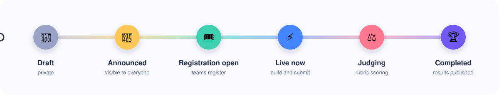
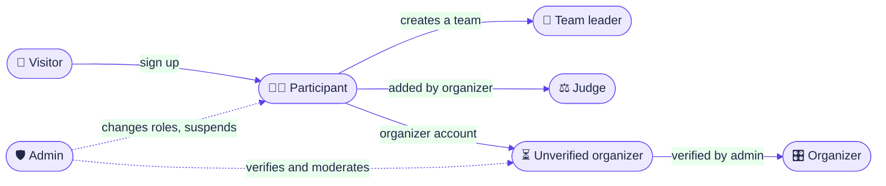
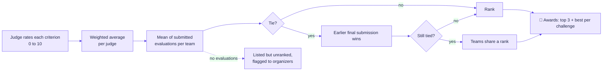
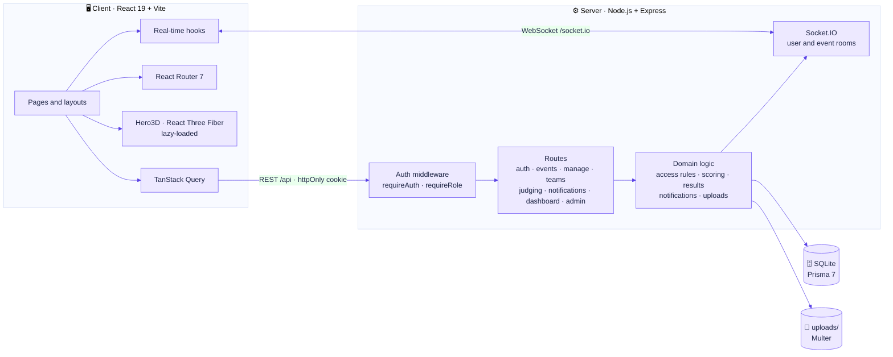
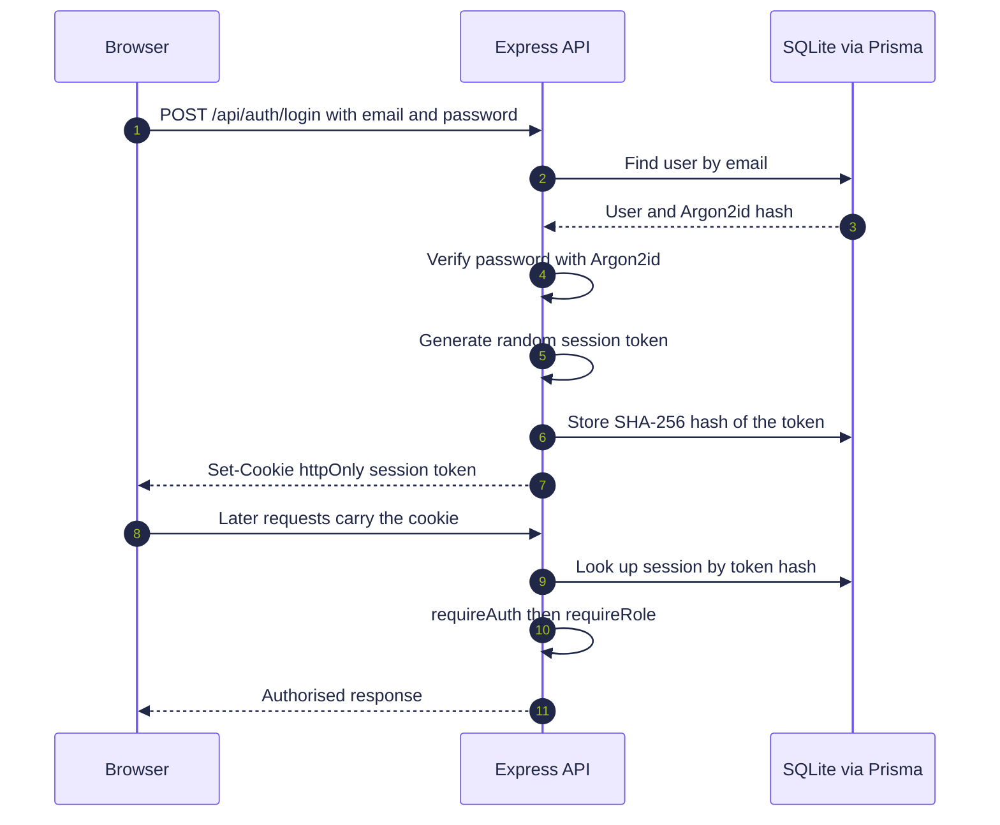
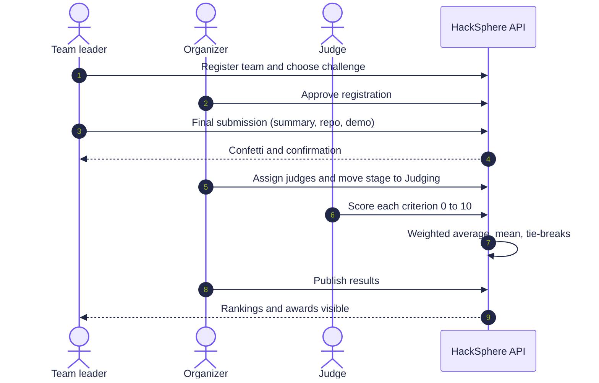
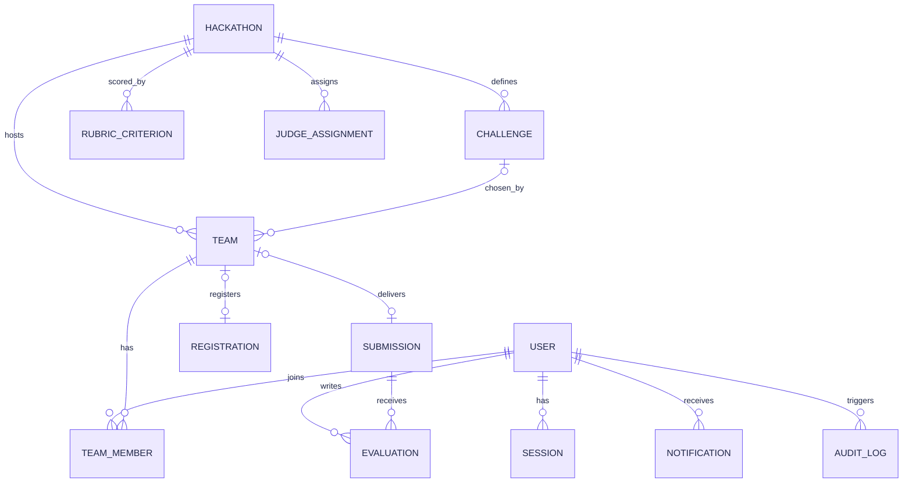
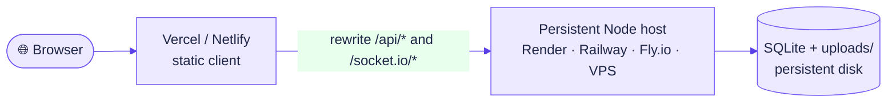

<div align="center">


<a href="https://github.com/LoganthP/HackSphere">
  
</a>

<br/>


<br/>

**[✨ Features](#-features)** &nbsp;•&nbsp;
**[🧭 Lifecycle](#-hackathon-lifecycle)** &nbsp;•&nbsp;
**[🏗️ Architecture](#%EF%B8%8F-architecture)** &nbsp;•&nbsp;
**[🧰 Tech Stack](#-tech-stack)** &nbsp;•&nbsp;
**[🚀 Getting Started](#-getting-started)** &nbsp;•&nbsp;
**[🌍 Deployment](#-deployment)**

</div>


## 📖 About

**HackSphere** is a full-stack, role-based hackathon management platform that covers the whole event, from the first announcement to the published leaderboard.

| | |
| :-- | :-- |
| 🧑‍💻 **Participants** | discover events, form teams, pick a challenge and submit their build |
| 🎛️ **Organizers** | configure and run the entire hackathon: stages, challenges, rubric, registrations, judges, results |
| ⚖️ **Judges** | score projects against a weighted rubric and leave feedback |
| 🛡️ **Administrators** | verify organizers, moderate accounts and events, and review an audit trail |

The interface is **light-first**: a bright canvas, bento-grid dashboards, glass navigation, clay tiles and avatars, and neumorphic toggles. Dark mode is available as an optional, reduced theme (profile menu or **Profile → Appearance**).

<!--
📸 Add screenshots here once you have them, for example:
<p align="center">
  
  
</p>
-->


## ✨ Features

| | Feature | Details |
| :-: | :-- | :-- |
| 🔐 | **Role-based access** | One identity, several contexts. Every permission is enforced on the server; the UI only hides what a user can't use |
| 👥 | **Team formation** | Create or join one team per hackathon, invite members, request to join, transfer leadership, with team-size limits enforced |
| 🧩 | **Challenges** | Problem statements with optional team limits; the choice locks after a final submission |
| 📦 | **Submissions** | Needs an approved registration and a live hackathon; locks at the deadline unless the organizer grants an extension |
| ⚖️ | **Weighted judging** | Per-criterion 0 to 10 scores, weighted average, tie-breaks, conflict-of-interest declarations |
| 🏅 | **Results and awards** | Rankings stay private until published; top three plus best project per challenge are generated |
| 🔔 | **Real-time updates** | Socket.IO rooms per user and per event for live notifications |
| 📎 | **Secure uploads** | 15 MB limit, type allow-list, access-controlled downloads |
| 🧾 | **Audit log** | Admins can review sensitive actions: role changes, suspensions, verifications |
| 🎨 | **Light-first design system** | Bento, glass, clay and neumorphic surfaces, accessible by default |
| ♿ | **Accessibility** | Focus rings, skip links, linked error messages, keyboard-operable switches, `prefers-reduced-motion` respected |


## 🧭 Hackathon Lifecycle

Every hackathon moves through a clear set of stages. The stage colours are identical everywhere (badges, stepper and charts).

```mermaid
%%{init: {'theme':'base','themeVariables':{'primaryColor':'#EDE9FF','primaryBorderColor':'#7058F5','primaryTextColor':'#202747','lineColor':'#5A41E6','tertiaryColor':'#F8FAFF'}}}%%
stateDiagram-v2
    direction LR
    [*] --> Draft : organizer creates event
    Draft --> Announced : publish
    Announced --> RegistrationOpen : open registration
    RegistrationOpen --> Live : start hackathon
    Live --> Judging : submissions lock
    Judging --> Completed : publish results
    Completed --> [*]
```






## 👤 Roles and Permissions

| Role | How you get it | Can do |
| :-- | :-- | :-- |
| 👀 **Visitor** | Not signed in | Browse published hackathons, schedules, rules and results |
| 🧑‍💻 **Participant** | Default account | Create or join one team per hackathon, accept invitations, request to join teams, save hackathons |
| 🚩 **Team leader** | Creating a team (or receiving leadership) | Invite, approve requests, remove members, transfer leadership, choose the challenge, register, submit |
| 🎛️ **Organizer** | Organizer account verified by an admin, or added as co-organizer | Create events, move stages, manage challenges and rubric, review registrations, grant extensions, assign judges, announce, publish results |
| ⚖️ **Judge** | Added to a specific hackathon by its organizer | Score assigned final submissions, write feedback, declare conflicts of interest |
| 🛡️ **Admin** | Platform role | Change roles, suspend accounts (ends their sessions), verify organizers, moderate events, read the audit log |



### Rules the server enforces

- A person can be on **only one team per hackathon** (database unique constraint), and judges of a hackathon can't join a team in it.
- Team size limits apply to invitations, joins and registration.
- Problem statements can have a team limit; the challenge locks after a final submission.
- Submissions need an approved registration and a live hackathon, and lock at the deadline unless the organizer grants that team an extension.
- Final submissions require a challenge, a **50+ character summary**, a repository link and a demo or video link.
- The rubric locks once any judge starts scoring, so scores stay comparable.
- Judges can't score their own team; a conflict declaration removes their draft and notifies organizers.
- Rankings stay private until the organizer publishes them.


## ⚖️ Scoring

Each judge rates every criterion from **0 to 10**. A judge's score is the weighted average

$$
S = \frac{\sum_i w_i \, r_i}{\sum_i w_i}
$$

and a team's final score is the **mean of its submitted evaluations**.




## 🏗️ Architecture



### Authentication flow



### Submission to results



### Conceptual data model

> A simplified view of the main entities. The full schema (15 entities plus sessions and reset tokens) lives in [`server/prisma/schema.prisma`](server/prisma/schema.prisma).




## 🧰 Tech Stack

| Layer | Technology | Notes |
| :-- | :-- | :-- |
| 🎨 **Frontend** |    | SPA with fast HMR |
| 💅 **Styling** |  | Custom design tokens |
| 🧱 **Components** |  | Dialog, tabs, dropdown in a shadcn-style local kit (`client/src/components/ui.tsx`) |
| 🎞️ **Animation** |  | `motion/react`, respects reduced-motion |
| 🧊 **3D** |  | Landing hero only, lazy-loaded |
| 📊 **Charts** |  | Dashboards and analytics |
| 🔄 **Data** |   | Server state and routing |
| ⚙️ **Backend** |    | REST API with Zod validation |
| 🗄️ **Database** |   | `better-sqlite3` driver adapter |
| 🔑 **Auth** |   | Server-managed sessions, SHA-256 token hash in DB |
| 📡 **Real time** |  | Per-user and per-event rooms |
| 📤 **Uploads** |  | 15 MB limit, type allow-list, access-controlled downloads |
| 🧪 **Testing** |    | Unit, component and end-to-end |

> [!NOTE]
> **Prisma 7** needs `prisma.config.ts` (included) and generates the client into `server/src/generated/prisma`. `npm run setup` does this; re-run `npm run db:generate` after editing `schema.prisma`.


## 📁 Project Structure

```text
hacksphere/
├── server/
│   ├── prisma/schema.prisma      15 entities + sessions/reset tokens
│   ├── prisma/seed.ts            demo data for every stage and role
│   ├── src/
│   │   ├── index.ts              HTTP + Socket.IO bootstrap
│   │   ├── app.ts                Express app, routes, static client (prod)
│   │   ├── middleware/auth.ts    sessions, requireAuth, requireRole
│   │   ├── lib/                  access rules, scoring, results, notifications, uploads
│   │   └── routes/               auth, events, manage, teams, judging,
│   │                             notifications, dashboard, admin
│   └── tests/                    scoring unit tests, API smoke test
└── client/
    ├── src/
    │   ├── index.css             design tokens: palette, glass, clay, neumorphic
    │   ├── components/           UI kit, Dialog, Tabs, Toast, Countdown, Confetti,
    │   │                         Hero3D, EventCard
    │   ├── layouts/              public layout, app shell with role-aware sidebar
    │   ├── auth/                 session context
    │   ├── lib/                  API client, types, formatting, real-time hooks
    │   └── pages/                public, auth, app (participant/leader),
    │                             organize, judge, admin
    └── e2e/                      Playwright specs
```


## 🚀 Getting Started

### 1. Prerequisites

| Tool | Version |
| :-- | :-- |
| Node.js | **20.19 or newer** (22 LTS recommended) |
| npm | 10+ |
| OS | Windows, macOS or Linux |

> [!TIP]
> No database server is needed. SQLite is a single file (`server/dev.db`) that is created for you.

### 2. Clone

```bash
git clone https://github.com/LoganthP/HackSphere.git
cd HackSphere
```

### 3. Run it

Open **two terminals** in the project folder.

**Terminal 1: API server**

```bash
cd server
npm install
Copy-Item .env.example .env      # Windows PowerShell: copy .env.example .env
npm run setup                    # generates Prisma client, creates dev.db, loads demo data
npm run dev                      # http://localhost:4000
```

**Terminal 2: web app**

```bash
cd client
npm install
npm run dev                 # http://localhost:5173
```

Open **http://localhost:5173**. The dev server proxies `/api` and `/socket.io` to port 4000, so cookies and live updates work without extra configuration.

<details>
<summary><b>⚡ Shortcut: use the root scripts</b></summary>

<br/>

```bash
npm run install:all     # install server and client dependencies
npm run setup           # prepare the database
npm run dev:server      # terminal 1
npm run dev:client      # terminal 2
npm test                # run tests
```

</details>

### 4. Sign in with a demo account

Every account uses the password **`HackSphere@123`**. On the sign-in page (in development) you can click an account to fill it in.

| Role | Email | What to try |
| :-- | :-- | :-- |
| 🧑‍💻 Participant | `student@hacksphere.dev` | Accept Ananya's invitation to *Null Pointers* |
| 🚩 Team leader | `leader@hacksphere.dev` | Register *Null Pointers*, choose a challenge, invite members |
| 🎛️ Organizer | `organizer@hacksphere.dev` | Approve registrations, assign judges, publish *HealthHack* results |
| ⚖️ Judge | `judge@hacksphere.dev` | Score *DoseBuddy* and *ClinicFlow* in HealthHack Sprint |
| 🛡️ Admin | `admin@hacksphere.dev` | Verify the *Tech Club VVCE* organizer, review the audit log |
| ⏳ Unverified organizer | `techclub@hacksphere.dev` | See the verification-pending state |

### 5. Explore the seeded hackathons

The seed creates one hackathon at every stage:

| Hackathon | Stage |
| :-- | :-- |
| 🟡 *Campus Build Night* | Announced |
| 🟢 *CodeVerse 2026* | Registration open |
| 🔵 *GreenGrid* | Live |
| 🔴 *HealthHack Sprint* | Judging |
| 🟣 *FinTech Forge* | Completed, results published |
| ⚪ *AI for Bharat* | Private draft |

To start over at any time:

```bash
cd server && npm run db:reset
```


## 📜 Scripts

<table>
<tr>
<td valign="top" width="50%">

**`server/`**

| Command | Purpose |
| :-- | :-- |
| `npm run dev` | API with auto-reload |
| `npm start` | API without reload |
| `npm run setup` | Generate Prisma client, create tables, seed |
| `npm run db:reset` | Wipe the database and re-seed |
| `npm run db:seed` | Re-seed only |
| `npm run db:generate` | Regenerate the Prisma client |
| `npm test` | Unit tests (scoring, ranking, tie-breaks) |
| `npm run smoke` | 67 end-to-end API checks across all roles |
| `npm run typecheck` | TypeScript check |

</td>
<td valign="top" width="50%">

**`client/`**

| Command | Purpose |
| :-- | :-- |
| `npm run dev` | Vite dev server |
| `npm run build` | Typecheck and production build to `client/dist` |
| `npm test` | Component tests (Vitest + Testing Library) |
| `npm run e2e` | Playwright tests, desktop and mobile |

> Run `npx playwright install chromium` once before the first `npm run e2e`.

</td>
</tr>
</table>

> [!NOTE]
> `npm run smoke` needs a **fresh seed** and the server running.


## 🎨 Design System

| Swatch | Token | Value | Used for |
| :-: | :-- | :-- | :-- |
|  | Primary violet | `#7058F5` (`#5A41E6` for buttons, for contrast) | Brand, primary actions, focus rings |
|  | Electric blue | `#4285FF` | "Live now" stage, charts |
|  | Coral | `#FF7890` | "Judging" stage, alerts, unread badges |
|  | Sunny yellow | `#FFC857` | "Announced" stage, highlights, warnings |
|  | Mint | `#3DCFAE` | "Registration open" stage, success, progress |
|  | Canvas white | `#F8FAFF` | Page background |
|  | Text navy | `#202747` | Body text |

- **Type:** Bricolage Grotesque for headings, Figtree for body (bundled, so the app works offline).
- **Bento grid:** dashboards and the command center.
- **Glassmorphism:** sidebar, top bar, overlays, featured cards.
- **Claymorphism:** stat tiles, avatars, podium, empty-state icons, the 3D hero.
- **Neumorphism:** toggles, pressed buttons, active nav indicator only.
- **Motion:** one orchestrated reveal per screen, spring dialogs, sliding nav indicator, confetti only for registration and final submission. All motion respects `prefers-reduced-motion`.
- **Accessibility:** visible focus rings, skip links, labelled controls with linked error messages, keyboard-operable switches, text colour picked automatically for WCAG contrast on coloured surfaces.


## 🌍 Deployment

### Option A: Single host (simplest)

Build the client and let the API serve it:

```bash
cd client && npm run build
cd ../server && NODE_ENV=production npm start      # serves the app and API on :4000
```

Everything is on one origin, so session cookies work with the default `COOKIE_SAMESITE=lax`. Put it behind **HTTPS** (cookies are `Secure` in production).

### Option B: Split hosting

Use a **Vercel or Netlify** frontend plus a persistent Node host (Render, Railway, Fly.io or a VPS). The host needs a persistent disk for `dev.db` and `uploads/`, so serverless functions are not suitable.



| Approach | What to do |
| :-- | :-- |
| ✅ **Easiest: rewrite** | Add a rewrite on the frontend host so `/api/*` and `/socket.io/*` proxy to your API. The browser sees one site and cookies just work |
| 🔧 **Without a rewrite** | Set `VITE_API_URL=https://api.example.com` when building the client. On the server set `CLIENT_ORIGIN=https://your-frontend.app` and `COOKIE_SAMESITE=none` (requires HTTPS) |

> [!IMPORTANT]
> SQLite suits a classroom deployment and moderate single-server load. For multiple servers, switch the Prisma datasource to **PostgreSQL**.

### Configuration reference

| Variable | Where | Purpose |
| :-- | :-- | :-- |
| `PORT` | `server/.env` | API port (default `4000`) |
| `CLIENT_ORIGIN` | `server/.env` | Allowed frontend origin when split-hosted |
| `COOKIE_SAMESITE` | `server/.env` | `lax` for one origin, `none` for split hosting over HTTPS |
| `NODE_ENV` | server | `production` serves the built client and sets `Secure` cookies |
| `VITE_API_URL` | client build | API base URL when not using a proxy or rewrite |


## 🛠️ Troubleshooting

| Problem | Fix |
| :-- | :-- |
| "Can't reach the HackSphere server" | Start the API (`cd server && npm run dev`) before using the app |
| `npm install` fails building `better-sqlite3` or `argon2` | Use Node 20.19+ or 22 LTS, which have prebuilt binaries. On Windows, re-run the install from a fresh terminal |
| `Cannot find module '../generated/prisma/client'` | Run `npm run db:generate` in `server/` |
| Port 4000 or 5173 in use | Change `PORT` in `server/.env`; for the client run `npx vite --port 5174` and set `CLIENT_ORIGIN` to match |
| Password reset email never arrives | There is no mail server in the prototype. The reset link is printed in the API terminal and shown on screen in development |
| 3D shapes on the landing page don't appear | The hero needs WebGL; everything else works without it. Slower machines may take a few seconds in dev mode |
| Want a clean slate | `cd server && npm run db:reset` |


